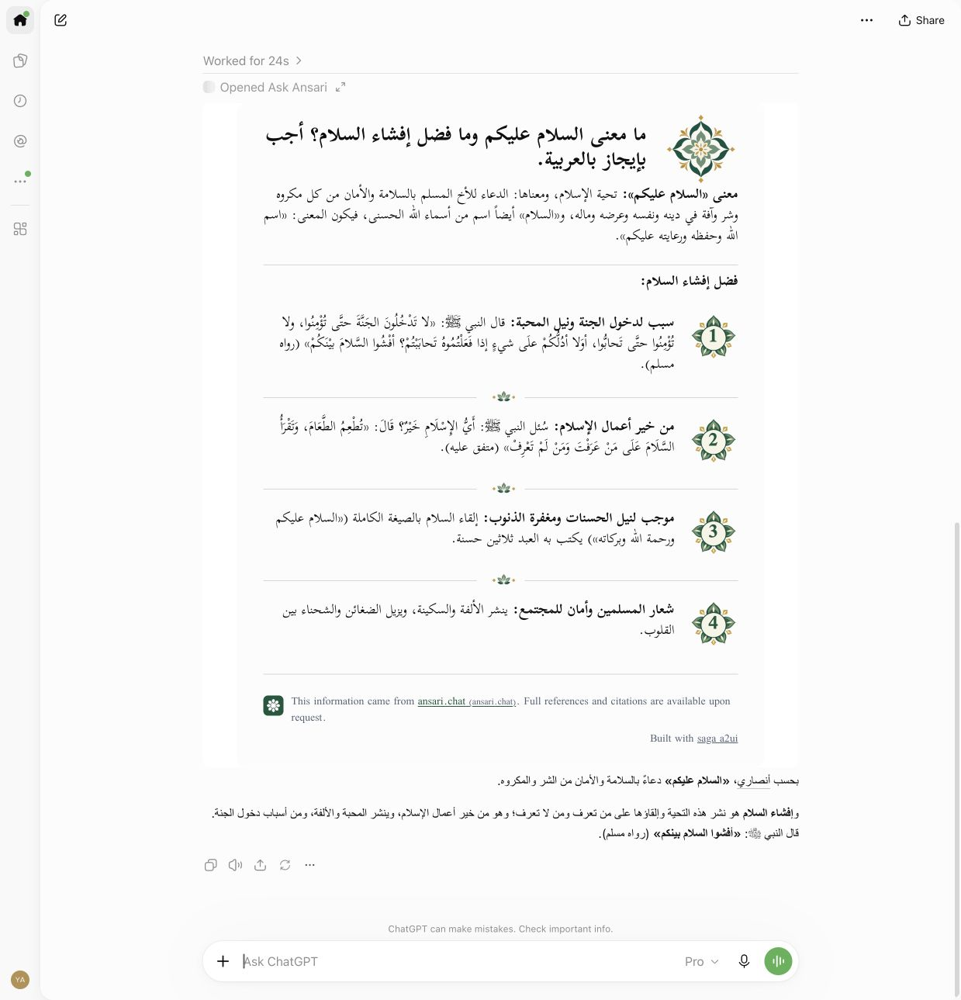
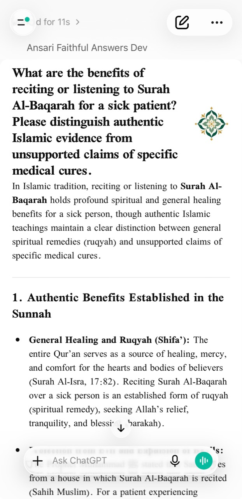

# Ansari MCP

A standalone MCP application. `answer_islamic_question` calls the Ansari API and returns its complete answer and attribution unchanged. SAGA links each result to one content-addressed, self-contained React card. The application owns Ansari branding, floral artwork, theme mapping and Hono HTTP hosting; SAGA owns content interpretation, FaithfulCard rendering, content policy, consent and MCP view linkage.

## How it works

[Explore the interactive walkthrough](docs/show-me-ansari-mcp.html) for the complete question-to-card flow, UI states, code ownership, build process and why it builds on SAGA. Download the self-contained HTML and open it in a browser; GitHub displays its source. The walkthrough uses synthetic content and makes no live requests.

## Screenshots

English and Arabic answer cards rendered in ChatGPT desktop web through the Dev connection on October 23, 2026. Both rendered on first load with application revision `ee7ea4a78933544c4a96577d7ffd7276df8ae037` and public npm SAGA SDK `0.7.6-rc.1`. Arabic headings, paragraphs and lists use RTL layout and the embedded Kitab fonts. The application owner also supplied the ChatGPT and Claude mobile captures below. These captures retain their original revision identity. The application owner accepts the existing ChatGPT, Claude and earlier Alexa baseline; the [consolidated host and release evidence](https://github.com/MachineWisdomAI/saga-a2ui/pull/321) records each observation and its limits. Earlier Alexa evidence is not presented as a fresh stable-version run, and the 239 successful RC HTTP requests measure transport activity rather than rendered answers.

### English


### Arabic



### ChatGPT mobile

User-provided capture of the Dev answer card in ChatGPT, showing English text and floral branding.



### Claude mobile

User-provided capture of the Dev answer card in Claude, showing Arabic text, RTL layout and numbered floral markers.


## Dependencies

SAGA is installed from the public npm registry at one exact release, `0.7.6` (stable), from the [0.7.6 release branch](https://github.com/MachineWisdomAI/saga-a2ui/tree/codex/release-0.7.6): the stack `@saga-a2ui/react-mcp-stack`
plus its exact-version siblings `@saga-a2ui/core`, `@saga-a2ui/components`, `@saga-a2ui/mcp` and `@saga-a2ui/react`. No private registry,
credential, SDK tarball, SDK workspace link or SDK-package override is involved, and the manifest pins an exact version rather than a tag or range.
`pnpm check:release --target beta` checks the pinned release against the registry and the lockfile; `--target production` additionally refuses a
prerelease. The Beta and Production deploy scripts run the corresponding gate before any build or deployment.

The application depends on one SAGA package, the stack `@saga-a2ui/react-mcp-stack`, plus React and React DOM, and imports
only its subpaths: `/faithful-card` (`FaithfulCardApp`, `startFaithfulCardApp`, and the definition's one `.result(...)` reader that reads the whole delivered result,
`useHostLink`, `readingProfile`) and its stylesheet in the view; `/content-policy` (`createContentPolicy`, `embedContentPolicy`)
in the build; `/server` (`registerPublicOperation`, `operationViewFromHtml`, `createServerBudgets`, `attachRequestLifetime`) in the
MCP server. The browser bundle holds no `/server` module. The stack's exact-version siblings come from the same release,
and its installed tree includes `@saga-a2ui/components` and `markdown-it`. SAGA owns its A2UI and Zod 3 dependency
context; the application uses Zod 4 for MCP. Do not add direct `@a2ui/react` or `@a2ui/web_core` dependencies or cast between their
schema types. The artwork owner has authorized contribution and redistribution with the application; see `assets/NOTICE.md`.

## Development

Requires Node 22.18 or later and pnpm 10.33. Install once from the repository root using its authoritative lockfile. Run the app explicitly; root build, test, typecheck and coverage retain their existing scope, while root lint includes this application.

```sh
pnpm install --frozen-lockfile --strict-peer-dependencies --filter ansari-mcp...
pnpm mcp build
pnpm mcp typecheck
pnpm mcp lint
pnpm mcp test
pnpm mcp exec playwright install chromium
pnpm mcp test:browser
pnpm mcp start
```

`build` writes `dist/view.html` and a bundled `dist/server/index.js`. No API/auth/frontend build or SDK source checkout is needed. `dev` runs the Node entry source (`src/node/index.ts`) after `build`. The synthetic browser harness is test-only and uses no credentials or live answers.

### Two hosting targets, one application

The same Hono application and official MCP handler (`src/server/fetch-app.ts`) run on Node/Docker and on Cloudflare Workers. Each target is a thin entry that supplies configuration, logging and the built card explicitly: `src/node/` (`index.ts` and `http-server.ts`: environment, filesystem read at start, listener, signals) and `src/worker/index.ts` (Worker bindings, console, the card bundled at build time). Both adapters import the shared code in `src/server/`; shared modules import neither adapter and read no file, environment or process object.

| Target | Build | Run locally | Check |
| --- | --- | --- | --- |
| Node/Docker | `pnpm build` writes `dist/` | `pnpm start` (or the Docker commands below) | `pnpm test` |
| Workers | `pnpm build:worker` writes the bundle to `dist-worker/` (Wrangler `deploy --dry-run`; nothing is published) | `pnpm dev:worker:dev` (Wrangler's local runtime, workerd; an environment is always named: `dev:worker:<env>`) | `pnpm test` |

```sh
# Clean frozen installation, then both artifacts and every check (Node, Workers and browser):
pnpm install --frozen-lockfile --strict-peer-dependencies --filter ansari-mcp...
pnpm mcp verify          # typecheck, build, build:worker, test, test:browser

# Run the Worker in Wrangler's local runtime under one declared environment (dev, beta or production). Its local secrets are `.dev.vars.<env>` only (git-ignored, and excluded from the Docker build context, together with `.wrangler/` and `dist-worker/`). The script refuses a generic `.dev.vars`, which Wrangler would read for every environment, and turns off Wrangler's `.env` fallback.
pnpm dev:worker:dev --var ANSARI_RELEASE:local-1
curl http://127.0.0.1:8787/health
```

The Worker takes the variables in the table below as Wrangler `vars` or secrets, not from `process.env`; `PORT` does not apply. `wrangler.jsonc` shares only the compatibility settings (`nodejs_compat`: the MCP SDK uses Node's crypto and buffer modules) and declares three named environments, `dev`, `beta` and `production`, each with its own Worker name, hostname, client label and allowlist; there is no top-level Worker, so a bare `wrangler deploy` publishes nothing. Secrets are never declared there. The `beta` and `production` hostnames are `replace-with-*` placeholders that the deploying owner must replace; do not deploy those environments while one remains. `test/parity-node.test.ts` and `test/parity-workers.test.ts` run one set of HTTP/MCP cases against the built Node server and the built Worker bundle in the local Workers runtime, each with a real synthetic upstream. They show local behaviour only; they are not a deployment, Cloudflare limit or host acceptance check. Node's signal shutdown stays in `test/lifecycle.test.ts`; the Worker's cleanup check is a caller disconnecting mid-call and the runtime stopping without leftover processes.

| Variable | Meaning |
| --- | --- |
| `PORT` | HTTP port (default 3000). |
| `ANSARI_API_BASE_URL` | Ansari API origin (default `https://api.askansari.ai`). |
| `ANSARI_API_AUTHORIZATION` | Optional upstream Authorization header. Supply through the environment; never commit it. |
| `ANSARI_CLIENT` | Upstream client label (default `ansari-mcp`). |
| `MCP_ALLOWED_HOSTS` | Comma-separated allowed HTTP Host names, without scheme. A configured list replaces local defaults; an explicitly empty list permits no Host. Only an absent variable defaults to localhost and 127.0.0.1. |
| `MCP_ALLOWED_ORIGINS` | Comma-separated allowed browser origin hostnames. A configured list replaces defaults; an explicitly empty list permits no Origin header value. Requests without Origin remain supported. |
| `MCP_RESPONSE_MODE` | `json` for modern MCP final-answer-only responses; otherwise SSE, which supports client-requested progress notifications. Older-host compatibility responses may use SSE. |
| `ANSARI_RELEASE` | Optional safe release identifier, embedded in served HTML and health/log records. |

`POST /mcp` serves stateless MCP requests through Hono and the official MCP request handler. Modern requests need no initialization; older hosts can use the handler’s stateless compatibility path. No MCP session IDs, session map, expiry timer or replay store are retained. `GET /mcp` and `DELETE /mcp` return 405. `/health` exposes the release. The HTML is supplied by the hosting target (read from `dist/` at Node start, bundled into the Worker), revision-stamped and fingerprinted once before the first request is served: the release is stamped first, so equal final bytes have equal identities and a release change legitimately changes the hash. Each request creates its own lightweight MCP server using that prepared view; resource bytes and identity stay fixed until restart. No demo, font server, alternative renderer or historical resource is served. Tool calls have a fresh 60-second budget; timeout yields a safe error and leaves subsequent calls usable. The same lifetime signal aborts the upstream fetch and response-body read when the request ends or the budget expires.

Closing a request server releases its budget even if it was never connected to a transport. On SIGINT or SIGTERM the listener stops accepting requests, closes MCP handlers and HTTP connections, and exits; unfinished calls are interrupted, including older-host SSE calls. Fetch cancellation does not guarantee that the remote backend has stopped processing. Caller-disconnect propagation depends on the host transport; the local Workers runtime does not establish immediate upstream cancellation from a client disconnect. Actual fetch cancellation at the request deadline is covered on both hosting targets.

## Workspace and container

This package lives at `apps/mcp` and is named `ansari-mcp`. The root `pnpm-lock.yaml` and `pnpm-workspace.yaml` are the only install inputs. `pnpm mcp <script>` targets this app. Shared TypeScript and lint tools use the workspace catalog; no application-local lockfile or standalone workspace is maintained.

The pnpm override pins `@a2ui/markdown-it` to `0.2.1`: A2UI React 0.13 permits adapter 0.2.2, but that adapter requires
incompatible web_core 0.14. The root workspace scopes this compatibility pin to `@a2ui/react@0.13.0>@a2ui/markdown-it`. Keep it until SAGA's supported dependency combination changes. SAGA's own Markdown parser
remains its private dependency. Do not add direct A2UI dependencies to this application.

The Docker build context is the repository root, including its lockfile and the shared configuration packages:

```sh
docker build -f apps/mcp/Dockerfile -t ansari-mcp .
docker run --rm -p 3000:3000 --env-file apps/mcp/.env ansari-mcp
```

The built card document names the SDK it was built from beside the application release: `<meta name="ansari-sdk">` and
`data-sdk-kind`, `data-sdk-version`, `data-sdk-source`, `data-sdk-stack-sha256` and `data-sdk-set-sha256` on `<body>`, next to
`data-release` (the application version) and, once served, `data-revision` (the deployed commit). They are read by `node scripts/sdk-identity.mjs`:
`data-sdk-kind` is `registry` and `data-sdk-version` is the pinned stack version; the registry integrity of every SAGA package is in the lockfile, so the
source and digest fields read `none`. An older cached card shows a different version.

The runtime contains only the compiled server and self-contained HTML. The HTML retains complete applicable SAGA Apache-2.0, third-party, application MIT, artwork and font notices in an inert comment. The build installs everything from the public registry with the committed lockfile; it needs no private registry credentials.

## Assets

Artwork is embedded as actual SVG/PNG data in application-local TypeScript modules. Kitab Regular and Bold are bundled into the HTML and loaded through binary `FontFace` sources. Some hosts block `data:` font URLs through their outer CSP; using the embedded bytes directly needs no font request or host policy change. Both weights must load before an answer appears, and teardown removes the owned font faces. No device font or font server is required. See `assets/NOTICE.md`. SDK licensing does not grant rights to Ansari artwork.

## Continuous verification

The `MCP application` workflow runs for app, lockfile, workspace, root manifest/ignore, workflow and shared lint configuration changes on PRs and develop/main pushes. It installs the root lockfile frozen, then runs app lint, typechecking, both builds, tests and browser checks. `bash apps/mcp/scripts/verify-container.sh` performs one uncached root-context Docker build and verifies health, synthetic tool calls, full attribution, safe failure/recovery and resource identity in a container with no external network or mounted files. It removes its container and image on exit. Node 22, pnpm 10.33, Docker and Chromium system dependencies are required.

This job needs no host credentials. Deployment and actual
ChatGPT, Claude and Alexa rendering remain separate integration checks.

The footer framework credit is controlled by `BRANDING.showSagaCredit` in
`src/view/branding.ts`. Set it to `false` to remove the credit. Its link uses
the same content policy as answer links; Strict displays an inert text credit.

Hono runs on Node through `@hono/node-server`; the official `@modelcontextprotocol/hono` middleware validates Host and Origin.

## MCP compatibility

The tool retains the legacy server's `answer_islamic_question` name, detailed description and input help, and `readOnlyHint: true` / `openWorldHint: true` annotations. It accepts 1–4,000 characters, matching the Ansari API. The earlier experimental RC exposed `ask_ansari`; a deployment owner must refresh host discovery when adopting this tool name. The endpoint remains `/mcp`. Replacing the existing `mcp.ansari.chat` service and changing its DNS are separate rollout actions.
